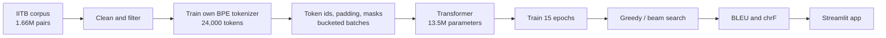
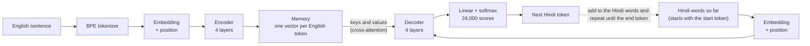
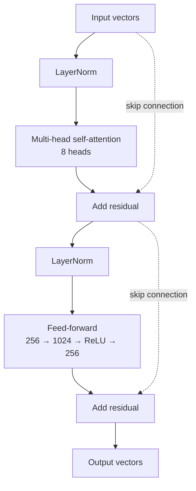
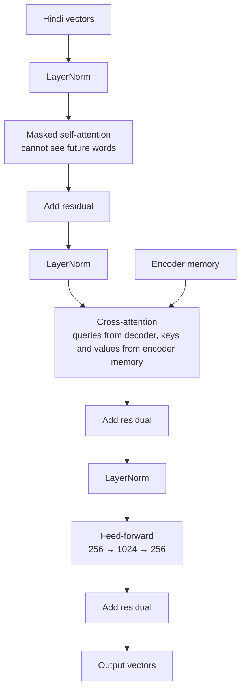

# English → Hindi Translator: a Transformer built from scratch

A machine translation model (English → Hindi) where **every part is written by hand in PyTorch and trained from zero**. There are no pretrained weights and no Hugging Face models. The project includes a **Streamlit app** with two tabs:

- **Translate:** type English, get Hindi.
- **Model X-ray:** an animated, 3Blue1Brown-style view of how one sentence flows through the network (neurons glow, attention lines connect words, the Hindi sentence is written word by word).

The main goal of the project is to **understand how sequence-to-sequence Transformers really work**, so the code is kept small and readable.

---

## Table of contents

1. [Quick look: what you get](#1-quick-look-what-you-get)
2. [Results](#2-results)
3. [How the whole pipeline works](#3-how-the-whole-pipeline-works)
4. [Model architecture](#4-model-architecture)
5. [Training details](#5-training-details)
6. [How Hindi is generated (greedy and beam search)](#6-how-hindi-is-generated-greedy-and-beam-search)
7. [Model X-ray](#7-model-x-ray)
8. [Project structure](#8-project-structure)
9. [Getting started](#9-getting-started)
10. [Re-training the model yourself](#10-re-training-the-model-yourself)
11. [Limitations](#11-limitations)
12. [Ideas to improve](#12-ideas-to-improve)
13. [Key terms](#13-key-terms)
14. [References and credits](#14-references-and-credits)

---

## 1. Quick look: what you get

| Item | Details |
|---|---|
| Task | English → Hindi sentence translation |
| Model | Transformer encoder-decoder, 4 + 4 layers, 8 attention heads, **13.5 million parameters** |
| Trained from scratch? | **Yes.** No transfer learning, no pretrained model or tokenizer |
| Tokenizer | Own BPE (subword) tokenizer, 24,000 tokens, shared by English and Hindi |
| Data | IITB English-Hindi corpus (about 1.66M raw pairs, 300k cleaned pairs used for training) |
| Quality | **BLEU 19.65, chrF 42.99** on 4,978 held-out sentences (greedy decoding) |
| App | Streamlit: Translate tab and Model X-ray tab |
| Hardware used | One laptop GPU with about 4.8 GB memory, about 10 minutes per epoch |

### Example translations (beam search, width 4)

| English | Hindi (model output) |
|---|---|
| How are you? | आप कैसे हैं? |
| Water is essential for life. | जीवन के लिए पानी आवश्यक है। |
| The government announced a new education policy. | सरकार ने नई शिक्षा नीति की घोषणा की। |
| He went to the market to buy vegetables. | वह सब्जियों को खरीदने के लिए बाजार में गया। |
| The President addressed the nation on Independence Day. | राष्ट्रपति ने स्वतंत्रता दिवस पर राष्ट्र को संबोधित किया। |
| Students should study hard to achieve success. | विद्यार्थियों को सफलता प्राप्त करने के लिए कठोर अध्ययन करना चाहिए। |

### Where it struggles (honest examples)

| English | What the model did |
|---|---|
| ...to form SPV array... | translated "SPV array" as `विशेष सरणी` (rare technical term) |
| ...make rounds of offices... | translated the idiom word by word: `राउंड ऑफिस बनाने` |
| I want to learn machine learning. | `मैं मशीन सीखना चाहता हूँ।` ("machine learning" became just "machine") |

<!-- Add screenshots here after uploading them to a docs/ folder, for example:


-->

---

## 2. Results

### Overall scores

Scores are computed with SacreBLEU on 4,978 test sentences that the model never saw during training or tokenizer training.

| Metric | Greedy decoding |
|---|---|
| **BLEU** | **19.65** |
| **chrF** | **42.99** |
| n-gram precisions (1 / 2 / 3 / 4-gram) | 51.2 / 25.8 / 14.4 / 8.8 |
| Brevity penalty | 0.972 (outputs are about 3% shorter than references) |
| Validation loss (last epoch) | about 2.63 (perplexity about 14) |

### Greedy vs beam search (random sample of 300 test sentences)

| Method | BLEU | chrF |
|---|---|---|
| Greedy | 20.31 | 43.91 |
| Beam search (width 4) | 21.81 | 45.35 |

Beam search gives about +1.5 BLEU, but it is much slower (about 0.4 s per sentence). Because the sample is small, treat the gap as a rough guide.

### Score by sentence length (greedy)

| Source length | Sentences | BLEU | chrF |
|---|---|---|---|
| 1 to 8 words | 1,443 | 22.55 | 44.01 |
| 9 to 15 words | 1,609 | 20.72 | 42.80 |
| 16 to 25 words | 1,216 | 18.96 | 42.67 |
| 26+ words | 710 | 18.59 | 43.16 |

The score falls gently as sentences get longer, but not sharply.

### How to read these numbers

- BLEU rewards matching the **one** reference translation. Hindi often has several correct translations, so BLEU under-estimates quality.
- The IITB corpus is **noisy**: some training and test pairs are misaligned (the Hindi sentence belongs to a different English sentence). Several of the lowest-scoring test sentences turned out to be wrong references, not wrong translations.
- Validation and test sets are **random samples from the cleaned corpus**, not the official IITB test split, so the scores should not be compared directly with published numbers.
- About 4.3% of outputs repeat a phrase (the references do this 1.5% of the time). Repetition is a known weakness of small models.

---

## 3. How the whole pipeline works



### Step 1: Data

- Dataset: **IITB English-Hindi parallel corpus** (Hugging Face name: `cfilt/iitb-english-hindi`), 1,662,110 sentence pairs in total.
- Cleaning rules (all in the data notebook):
  - drop empty rows and duplicate pairs, keep only **one Hindi translation per English sentence**
  - keep English sentences of 3 to 40 words and Hindi sentences of 3 to 50 words
  - drop pairs whose word-count ratio is above 2.5 (usually misaligned)
  - the Hindi side must contain Devanagari letters and be mostly Devanagari (less than 10% English letters)
  - drop software strings and placeholders (symbols like `% < > { } _ | @ #` and web links)
  - clean extra spaces and end Hindi sentences with the Hindi full stop `।`
- After the first filtering stage, about 853,000 pairs (51.4%) were left. From the cleaned pool we sampled **300,000 for training**, 5,000 for validation and 5,000 for testing.

### Step 2: Tokenizer (trained from scratch)

- Word-level vocabularies fail here: in the data, about **55 to 60% of the unique words appear only once**. A word-level model would meet many words it never learned.
- Solution: **BPE (Byte Pair Encoding)** with SentencePiece. Rare words are split into smaller pieces, so nothing is unknown.
- One **shared vocabulary of 24,000 tokens** for English and Hindi (the scripts do not overlap, so they share it without conflict). The shared vocabulary also lets us share one embedding table across the whole model.
- Special tokens: `<pad>` = 0, `<unk>` = 1, `<bos>` = 2 (start), `<eos>` = 3 (end).
- The tokenizer is trained on the **training text only**, so nothing leaks from validation or test.
- Result: about 1.3 tokens per word in both languages, and only about 0.15% unknown tokens.

```
"How are you?"            ->  ▁How  ▁are  ▁you  ?
"भारत एक बहुत बड़ा देश है।"  ->  ▁भारत  ▁एक  ▁बहुत  ▁बड़ा  ▁देश  ▁है  ।
```

### Step 3: Batches, padding and masks

Each sentence pair becomes:

```
Source (English)  :  <bos>  The  government  announced ...  <eos>
Target (Hindi)    :  <bos>  सरकार  ने  एक  नई ...          <eos>

Decoder input     :  <bos>  सरकार  ने  एक  नई ...          (target without the last token)
Decoder must output:        सरकार  ने  एक  नई ...  <eos>    (target without the first token)
```

This is called **teacher forcing**: during training the decoder always sees the correct previous Hindi words, and has to predict the next one at every position at the same time.

- **Padding:** sentences in a batch have different lengths, so shorter ones are filled with `<pad>`.
- **Bucketing:** sentences of similar length are batched together. This cut wasted padding from **59.3% to 11.4%**, so training is much faster.
- **Padding mask:** attention is not allowed to look at `<pad>` tokens.
- **Causal (look-ahead) mask:** a Hindi word is not allowed to look at future Hindi words. For 5 positions it looks like this (1 = allowed to look):

```
1 0 0 0 0
1 1 0 0 0
1 1 1 0 0
1 1 1 1 0
1 1 1 1 1
```

### Step 4: Model, training, decoding, evaluation

These are explained in the next sections.

---

## 4. Model architecture

### The big picture



The same picture as text, with the tensor shapes for one sentence (S = English tokens, T = Hindi tokens so far):

```
 ENCODER                                               DECODER
 English token ids          (1, S)                     Hindi token ids so far      (1, T)
        |                                                     |
 Embedding x sqrt(256)      (1, S, 256)                Embedding x sqrt(256)       (1, T, 256)
        |                                                     |
 + Positional encoding      (1, S, 256)                + Positional encoding       (1, T, 256)
        |                                                     |
 +--------------------+                                +-----------------------------+
 | Encoder layer  x 4 |                                | Decoder layer  x 4          |
 |  self-attention    |                                |  masked self-attention      |
 |  feed-forward      |   -- memory (K and V) -->      |  cross-attention  <---------+--- from encoder
 +--------------------+                                |  feed-forward               |
        |                                              +-----------------------------+
 Final LayerNorm = MEMORY   (1, S, 256)                       |
                                                       Final LayerNorm             (1, T, 256)
                                                              |
                                                       Linear 256 -> 24,000        (1, T, 24000)
                                                              |
                                                       softmax -> next-word probabilities
```

### One encoder layer and one decoder layer

**Encoder layer** (repeated 4 times). Words look at each other, then each word is processed alone:



**Decoder layer** (repeated 4 times). Hindi words look back at earlier Hindi words, then look at the English sentence, then each word is processed alone:



### Model settings

| Setting | Value |
|---|---|
| Vocabulary size | 24,000 (shared, English and Hindi) |
| `d_model` (vector size per token) | 256 |
| Attention heads | 8 (each head has 32 dimensions) |
| Encoder layers / decoder layers | 4 / 4 |
| Feed-forward size `d_ff` | 1,024 |
| Dropout | 0.1 |
| Longest sequence | 64 tokens in training (positional table up to 128) |
| **Total parameters** | **13,517,824** (embedding table 6.1M is shared, encoder 3.2M, decoder 4.2M) |

### Attention in one line

```
Attention(Q, K, V) = softmax( Q · Kᵀ / √d_k ) · V
```

- **Q (query):** what this word is looking for. **K (key):** what each word offers. **V (value):** the information each word carries.
- The softmax turns scores into weights that add up to 1, and each word's new vector is a **weighted mix** of the values.
- **Self-attention:** Q, K and V all come from the same sentence. **Cross-attention:** Q comes from the Hindi side, K and V come from the English memory. This is where "which English word should I translate now?" is decided.
- **8 heads** let the model look for 8 different patterns at the same time.

### Design choices

| Choice | Why |
|---|---|
| Sinusoidal positional encoding | Attention has no sense of word order, so each position gets a unique sin/cos fingerprint added to the embedding |
| Embedding multiplied by √256 | Keeps the embedding from being drowned out by the positional encoding |
| **Pre-LayerNorm** (normalise before each block) | More stable training than the original post-norm layout, with no delicate tuning |
| Residual connections | Let gradients flow through deep stacks |
| **Weight tying** (one embedding table for encoder input, decoder input and output layer) | Saves about 6M parameters, works because of the shared vocabulary |
| Xavier initialisation | Good starting weights for attention layers |

---

## 5. Training details

| Setting | Value |
|---|---|
| Training pairs | 298,488 (after dropping pairs longer than 62 tokens) |
| Batch size | 64 sentences (bucketed), 4,664 batches per epoch |
| Epochs | 15 (about 10 minutes each) |
| Loss | Cross-entropy, **padding ignored**, **label smoothing 0.1** |
| Optimizer | Adam (β1 = 0.9, β2 = 0.98, ε = 1e-9) |
| Learning rate | **Warmup for 4,000 steps, then decay** (peak about 7e-4) |
| Mixed precision | fp16 (faster, lighter on memory) |
| Gradient clipping | 1.0 |
| Checkpoints | `last.pt` every epoch, `best.pt` when validation loss improves |

**Why warmup?** Attention is unstable with a large learning rate at the start. The rate climbs slowly for 4,000 steps and then slowly falls.

**Why label smoothing?** It stops the model from becoming over-confident, which usually helps translation quality.

**Training curve (validation):** loss fell from about 4.7 after epoch 1 to about 2.63 after epoch 15, and perplexity from about 107 to about 14. The curve was flattening at the end, so the model is limited more by its size and the amount of data than by training time. Validation loss is lower than training loss only because the training loss includes label smoothing and dropout.

---

## 6. How Hindi is generated (greedy and beam search)

The encoder runs **once** on the English sentence. Then the decoder writes Hindi **one token at a time**, feeding its own output back in:

```
Step 1: <bos>                          -> सरकार
Step 2: <bos> सरकार                    -> ने
Step 3: <bos> सरकार ने                 -> एक
   ...
Step N: <bos> सरकार ने ... की          -> <eos>   (stop)
```

- **Greedy decoding:** always pick the single most likely next token. Fast, but one early mistake cannot be undone.
- **Beam search (width 4):** keep the 4 best partial sentences at every step and choose the best finished one. Slower, usually a bit better.
- **Length penalty:** beam search tends to prefer short sentences, so scores are divided by `((5 + length) / 6) ^ alpha` with `alpha = 0.6`.
- **Long text:** the app splits pasted text into sentences, translates each sentence separately and joins the results (the model was trained on single sentences).

---

## 7. Model X-ray

The **Model X-ray** tab replays one sentence travelling through the real, trained network.

- **Encoder part:** English words appear, become embedding neurons, get their position added, and then go through the 4 layers. Gold lines show **attention** (a thicker line means one word looks more at another).
- **Click an English word** to follow only its path. Everything else fades.
- **Decoder part:** for each Hindi word you see blue lines looking back at the Hindi words written so far, green lines looking at the English words (cross-attention), the feed-forward neurons lighting up, and then the **top 5 candidate words** glowing by probability. The winner is written at the top.
- Controls: play/pause, step back/forward, timeline slider, speed, choose **attention head 1 to 8 or the average**, hide labels.

**What is real and what is illustration:**

| Part of the picture | Source |
|---|---|
| Glow and colour of neurons (yellow positive, blue negative) | **Real activations** from the model; each word's 256 numbers are grouped into 8 dots |
| Feed-forward neuron glow | **Real**; the 1,024 hidden neurons are grouped into 8 dots |
| Attention lines (word to word, English to Hindi) | **Real attention weights** |
| Next-word candidates and their glow | **Real probabilities** |
| Thin lines between dots inside one word | **Illustration only**: brightness is the product of the two connected activations, not the real weight values |

The X-ray traces **greedy** decoding and shows at most 14 tokens, so use short sentences.

<!--  -->

---

## 8. Project structure

```
.
├── notebooks/                 # the full build, phase by phase (data, tokenizer, model, training, evaluation, app)
├── model.py                   # the Transformer (positional encoding, multi-head attention, encoder, decoder)
├── translator.py              # loads the model; greedy decoding, beam search, sentence splitting
├── xray.py                    # records the model's internals for one sentence
├── xray_template.html         # the animation player used by the X-ray tab
├── app.py                     # Streamlit app (Translate tab and Model X-ray tab)
├── config.json                # special token ids, max length, batch size
├── tokenizer/
│   └── bpe.model              # the trained BPE tokenizer
├── exports/
│   └── model_inference.pt     # trained weights, about 54 MB (NOT included in this repository, see below)
├── requirements.txt
└── README.md
```

| File | What it does |
|---|---|
| `model.py` | All Transformer building blocks written from scratch |
| `translator.py` | `Translator` class: loads the tokenizer and weights, translates text |
| `xray.py` | Runs a sentence through the model by hand and saves every step for the animation |
| `app.py` | The web interface |

---

## 9. Getting started

### 1) Install

Python 3.10 or newer is recommended (built with Python 3.11).

```bash
git clone <your-repo-url>
cd <your-repo-folder>
pip install -r requirements.txt
```

The app also runs on a CPU (the model is small), but beam search is slower there.

### 2) Get the trained weights

The trained weights file `exports/model_inference.pt` (about 54 MB) is **not stored in this repository**. Choose one option:

- **Option A: download it.** <!-- Add your link here, for example a Google Drive or Hugging Face link --> Download the file and place it at `exports/model_inference.pt`.
- **Option B: train it yourself.** Follow [Section 10](#10-re-training-the-model-yourself). The last export step of the notebook creates this file.

### 3) Run the app

```bash
python -m streamlit run app.py
```

Open the address shown in the terminal (usually `http://localhost:8501`).

- **Translate tab:** type or paste English text, press **Translate**. In the sidebar you can switch between beam search and greedy, and change the beam width and length penalty.
- **Model X-ray tab:** pick an example or type a short sentence, press **Show X-ray**, and watch the animation.

### 4) Use it as a Python library

```python
from translator import Translator

tr = Translator()                                   # loads tokenizer + weights
result = tr.translate("The government announced a new education policy.", mode="beam")

print(result["translation"])                        # Hindi text
for english, hindi in result["pairs"]:              # sentence by sentence
    print(english, "->", hindi)
```

---

## 10. Re-training the model yourself

Install the extra packages used by the notebooks:

```bash
pip install pandas pyarrow matplotlib sacrebleu tqdm
```

Download the **IITB English-Hindi** dataset (Hugging Face: `cfilt/iitb-english-hindi`, the train / validation / test parquet files) into a folder, and put that folder path in the `DATA_DIR` variable at the top of the data notebook.

Run the notebook phases in order. Each phase saves files that the next one needs:

| Phase | What happens | Files created |
|---|---|---|
| 1. Data | Load all files, explore lengths and vocabulary, clean, split | `processed_data/train, val, test .parquet` |
| 2. Tokenizer | Train the BPE tokenizer, check it, encode all sentences | `tokenizer/bpe.model`, `*_tok.parquet` |
| 3. Dataset | Dataset class, bucketed DataLoader, masks | `config.json` |
| 4. Model | Build the Transformer, count parameters, masking tests | `model.py` |
| 5. Training | Train 15 epochs with validation and checkpoints | `checkpoints/best.pt`, `last.pt` |
| 6. Inference | Greedy decoding and beam search | none |
| 7. Evaluation | BLEU, chrF, scores by length, error analysis | `outputs/test_translations.csv` |
| 8. App | Export the slim model, write `translator.py` and `app.py` | `exports/model_inference.pt` |
| 9. X-ray | Record the internals, build the animation, add the app tab | `xray.py`, `xray_template.html` |

Training took about **10 minutes per epoch** (15 epochs, about 2.5 hours) on a laptop GPU with 4.8 GB of memory. The worst-case batch used about 2.1 GB, so smaller GPUs should work with a smaller batch size.

---

## 11. Limitations

- **Small model, small data:** 13.5M parameters trained on 300k pairs. It is a learning project, not a production translator.
- **Works best on short, everyday sentences.** Rare words, names, acronyms and idioms are often wrong.
- **Domain bias:** the IITB corpus contains a lot of software messages, government text, religious text and legal text, so the model is strongest on those styles.
- **Noisy data:** some training pairs are misaligned or contain odd symbols, and this limits quality and makes BLEU look lower than it is.
- **Repetition and dropped words** can happen, especially in longer sentences.
- **Sentence length limit:** the model was trained on sentences of up to 62 tokens. Longer sentences are cut.
- **X-ray limits:** it shows at most 14 tokens and traces greedy decoding.

---

## 12. Ideas to improve

- Use more of the roughly 850,000 cleaned pairs instead of 300,000.
- Clean remaining noise in the data, such as HTML codes (`&amp;`) and spaced-out apostrophes.
- Train a larger model for more epochs (with a bigger GPU, or Google Colab).
- Add **back-translation** (translate Hindi text to English to create more training pairs).
- Average the last few checkpoints.
- Add a repetition penalty during beam search.
- Evaluate on a cleaner, human-made test set.

---

## 13. Key terms

| Term | Meaning in this project |
|---|---|
| **Token** | A piece of text (a word or part of a word) turned into a number |
| **BPE** | Method that builds a vocabulary of frequent pieces, so rare words are split instead of being unknown |
| **Embedding** | A list of 256 numbers that represents one token |
| **Positional encoding** | A fingerprint added to the embedding so the model knows word order |
| **Self-attention** | Each word looks at the other words in its own sentence |
| **Cross-attention** | Each Hindi word looks at the English words |
| **Mask** | A rule that blocks attention to padding or to future words |
| **Teacher forcing** | Training the decoder with the correct previous words as input |
| **Greedy / beam search** | Ways of choosing the next word while generating |
| **BLEU / chrF** | Scores that compare the model output with a reference translation (words / characters) |
| **Perplexity** | `exp(loss)`; roughly how many words the model is torn between at each step |

---

## 14. References and credits

- Vaswani et al., 2017. *Attention Is All You Need.*
- Kunchukuttan, Mehta, Bhattacharyya, 2018. *The IIT Bombay English-Hindi Parallel Corpus.* (LREC 2018)
- Kudo and Richardson, 2018. *SentencePiece: A simple and language independent subword tokenizer.*
- Xiong et al., 2020. *On Layer Normalization in the Transformer Architecture.* (pre-LayerNorm)
- Post, 2018. *A Call for Clarity in Reporting BLEU Scores* (SacreBLEU).

Built with Python, PyTorch, SentencePiece, SacreBLEU and Streamlit. Please check the license of the IITB corpus before redistributing any data, and add a license file for your own code (for example MIT).