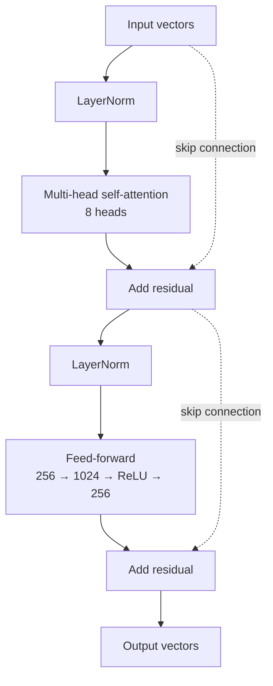
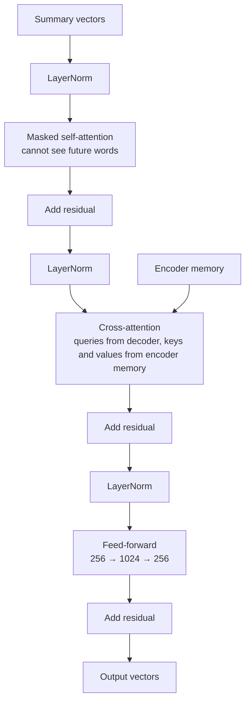

# News Article Summarizer: a Transformer built from scratch

A text summarization model where **every part is written by hand in PyTorch and trained from zero**. There are no pretrained weights and no Hugging Face models. It reads a news article and writes a short summary, and a **Streamlit app** lets you try it, with the simple **Lead-3 baseline** (the first three sentences of the article) shown next to the model's summary.

This is the second project in a series. It uses the same Transformer code as my [English to Hindi translator](#), applied to a harder problem: long inputs, short outputs, and facts that must be right.

The main goal is to **understand how sequence-to-sequence Transformers really work**, so the code is small and readable. The results are reported honestly: **the model does not beat the Lead-3 baseline**, and Section 7 explains why.

---

## Table of contents

1. [Quick look: what you get](#1-quick-look-what-you-get)
2. [Results](#2-results)
3. [How the whole pipeline works](#3-how-the-whole-pipeline-works)
4. [Model architecture](#4-model-architecture)
5. [Training details](#5-training-details)
6. [How summaries are generated](#6-how-summaries-are-generated)
7. [What goes wrong, and why](#7-what-goes-wrong-and-why)
8. [Project structure](#8-project-structure)
9. [Getting started](#9-getting-started)
10. [Re-training the model yourself](#10-re-training-the-model-yourself)
11. [Limitations](#11-limitations)
12. [Ideas to improve](#12-ideas-to-improve)
13. [Key terms](#13-key-terms)
14. [References and credits](#14-references-and-credits)

---

## 1. Quick look: what you get

| Item | Details |
|---|---|
| Task | News article summarization (English) |
| Model | Transformer encoder-decoder, 4 + 4 layers, 8 attention heads, **11.5 million parameters** |
| Trained from scratch? | **Yes.** No transfer learning, no pretrained model or tokenizer |
| Tokenizer | Own BPE (subword) tokenizer, 16,000 tokens, byte fallback (no unknown tokens) |
| Data | CNN/DailyMail 3.0.0, about 95,000 training articles used (88,127 after filtering) |
| Input limit | First **400 tokens** of the article (about 300 words) |
| Quality | **ROUGE-1 28.9, ROUGE-2 6.4, ROUGE-L 19.0** (Lead-3 baseline: 40.2 / 17.7 / 25.4) |
| App | Streamlit: paste an article, see the model summary next to Lead-3 |
| Hardware used | One laptop GPU with about 4.3 GB memory, about 16.5 minutes per epoch |

### What it does well

- Writes **fluent English** summaries of about 32 words, in sentence form.
- Usually picks the **right topic** (a football injury, an FBI chase, a court ruling).
- Repeated phrases are mostly removed by blocking repeated 3-word sequences.

### Where it struggles (real outputs from the test set)

| Article | Reference summary (shortened) | Model output | What is wrong |
|---|---|---|---|
| Anne Frank's death date | Museum: Anne Frank died earlier than previously believed. | Anne Bergenen, 31, was imprisoned for the death of Frank Holocaust. She was found in a secret camp at the age of 15. She was released from the camp in March 1945. | Garbled name (the camp is Bergen-Belsen), an invented age, and it misses the main news |
| A footballer's knee injury | Austria drew 1-1 against Bosnia-Herzegovina. David Alaba picked up a knee injury. | David Bosnigo will be playing for the season for the first time since the season. Bayern Munich's Bayern Munich star has been ruled out for the last season. | "Bosnia" became "Bosnigo", and phrases are repeated |
| An FBI chase | FBI agents and a suspected serial robber exchange gunfire. Two agents are injured. | In the two-year-old FBI agents were chasing a cop in the Georgia. The FBI agents are trying to rob the FBI agents. | Right topic, broken grammar and wrong roles |

In another test the model wrote that a person had been arrested, which the article never said. Small models write fluent text even when they are unsure, so **never trust the output for facts.**

<!-- Add screenshots here after uploading them to a docs/ folder, for example:

-->

---

## 2. Results

### Overall scores

ROUGE compares the model's summary with the human-written summary (the "highlights" of each article). Scores are computed with the `rouge-score` package (with stemming) on **1,043 test articles**: every 11th article of the official test split, so both news styles are included.

| System | ROUGE-1 | ROUGE-2 | ROUGE-L | Average words |
|---|---|---|---|---|
| Lead-3 (first 3 sentences, no AI) | **40.2** | **17.7** | **25.4** | 75.7 |
| **Our model (greedy decoding)** | 28.9 | 6.4 | 19.0 | 32.3 |

For context, Lead-3 on the **full test set (11,463 articles)** scores 40.0 / 17.4 / 24.9, which matches the numbers usually published for this dataset, so the data and the scoring are correct.

### By article style

CNN/DailyMail mixes two sources. The first training file I downloaded was almost entirely **Daily Mail** articles, while the test set also contains a block of **CNN** articles (the first rows, about 1,100 of them). That is a style the model hardly saw in training.

| Test articles | System | n | ROUGE-1 | ROUGE-2 | ROUGE-L |
|---|---|---|---|---|---|
| Daily Mail style | Lead-3 | 943 | 41.3 | 18.4 | 25.9 |
| Daily Mail style | Model | 943 | 29.4 | 6.6 | 19.2 |
| CNN style | Lead-3 | 100 | 29.7 | 11.0 | 20.3 |
| CNN style | Model | 100 | 24.6 | 5.0 | 16.8 |

The style gap exists but is small overall, because CNN-style articles are only about 10% of the test set.

### Greedy vs beam search (59 Daily Mail style articles)

| Method | ROUGE-1 | ROUGE-2 | ROUGE-L | Average words |
|---|---|---|---|---|
| Greedy | 28.5 | 6.3 | 19.1 | 32.5 |
| Beam search (width 4) | 27.9 | 6.9 | 18.6 | 27.4 |

Beam search showed no benefit, so **greedy decoding is the app default**. The sample is small, so treat small differences as noise.

### How to read these numbers

- **The model is clearly below Lead-3.** The gap is largest on ROUGE-2 (6.4 against 17.7): Lead-3 copies exact phrases from the article, while the model almost never does.
- ROUGE-L here is the plain version, not the sentence-level version many papers report, so only compare the overall level.
- ROUGE only measures word overlap with one reference. It cannot tell whether a summary is **true**, which matters a lot here.
- In an early check on 100 articles, about 95% of the model's 3-word sequences were new text, not copied from the article (for the reference summaries it was about 78%).

---

## 3. How the whole pipeline works


### Step 1: Data

- Dataset: **CNN/DailyMail 3.0.0** (Hugging Face name: `abisee/cnn_dailymail`). Each row is a news `article` and its `highlights` (the summary).
- Because of the compute budget, I used **one of the three training files**: 95,704 articles, of which 95,227 remained after cleaning. For validation I used 3,000 articles, and the **full official test split** (11,463 articles) for the final scores.
- Typical size: the median article has about 645 words, and the median summary about 48 words (about 7% of the article).

### Step 2: Cleaning

- News boilerplate removed, for example `By . Daily Mail Reporter . PUBLISHED: . 22:22 EST, 12 December 2013 . | . UPDATED: ...` and datelines like `LONDON, England (CNN) --`. Without this, the model wastes effort learning headers.
- The highlight lines were joined into one paragraph and spacing before punctuation was fixed (`word .` becomes `word.`).
- Kept articles of at least 50 words and summaries of 10 to 150 words, and removed duplicate articles (99.5% of the articles were kept).

### Step 3: Tokenizer (trained from scratch)

- **BPE (Byte Pair Encoding)** with SentencePiece, 16,000 tokens, trained only on the training text (sentences from 40,000 articles plus all summaries).
- **Byte fallback** is switched on, so a rare name or symbol is split into bytes instead of becoming an unknown token. In 5,000 articles there were **0 unknown tokens**.
- Special tokens: `<pad>` = 0, `<unk>` = 1, `<bos>` = 2 (start), `<eos>` = 3 (end).
- About 1.3 tokens per word. A median article is about 818 tokens and a median summary about 61 tokens.

```
"Dr Petit said the family would spend Christmas together in Connecticut."
 ->  ▁Dr  ▁Pet  it  ▁said  ▁the  ▁family  ▁would  ▁spend  ▁Christmas  ▁together  ▁in  ▁Connecticut  .
```

### Step 4: Cutting long articles

Attention memory grows with the **square** of the input length, so the model reads only the first **400 tokens** and writes at most **110 tokens**. I measured the cost of this before choosing:

| Input limit | Share of the article kept | Summary words still found in the kept text |
|---|---|---|
| 256 tokens | 28% | 70.0% |
| **400 tokens (used)** | **43%** | **77.9%** |
| 640 tokens | 66% | 83.8% |
| whole article | 100% | 87.6% |

So 400 tokens keep about 89% of what a summary could draw from, for under half of the compute. This works because news puts the key facts first. Training pairs whose summary was longer than the 110-token limit (7,100 of them) were dropped, so the model never learns to stop in the middle of a sentence.

### Step 5: Batches, padding and masks

```
Source (article)    :  <bos>  first 398 tokens of the article  <eos>
Target (summary)    :  <bos>  summary tokens ...               <eos>

Decoder input       :  <bos>  summary tokens ...               (target without the last token)
Decoder must output :         summary tokens ...        <eos>  (target without the first token)
```

This is **teacher forcing**: the decoder always sees the correct previous summary words and predicts the next one at every position at the same time.

- **Bucketing** groups summaries of similar length, which cut wasted padding on the target side from 37.8% to 7.6%. Almost all articles are cut to 400 tokens, so source padding is below 1%.
- **Padding mask:** attention may not look at `<pad>`. **Causal mask:** a summary word may not look at future summary words.

---

## 4. Model architecture

It is the **same `model.py` as the translation project**, with a 16,000-token vocabulary and a position table of 512.

### The big picture

```mermaid
flowchart LR
    ART["News article<br/>(first 400 tokens)"] --> TOK1["BPE tokenizer"] --> EMB1["Embedding<br/>+ position"] --> ENC["Encoder<br/>4 layers"] --> MEM["Memory<br/>one vector per article token"]
    SUMW["Summary words so far<br/>(starts with the start token)"] --> EMB2["Embedding<br/>+ position"] --> DEC["Decoder<br/>4 layers"] --> OUT["Linear + softmax<br/>16,000 scores"] --> NEXT["Next summary token"]
    MEM -- "keys and values<br/>(cross-attention)" --> DEC
    NEXT -. "add to the summary and repeat until the end token" .-> SUMW
```



The same picture as text, with tensor shapes (S = article tokens, up to 400; T = summary tokens so far, up to 109):

```
 ENCODER                                               DECODER
 Article token ids          (1, S)                     Summary token ids so far    (1, T)
        |                                                     |
 Embedding x sqrt(256)      (1, S, 256)                Embedding x sqrt(256)       (1, T, 256)
        |                                                     |
 + Positional encoding      (1, S, 256)                + Positional encoding       (1, T, 256)
        |                                                     |
 +--------------------+                                +-----------------------------+
 | Encoder layer  x 4 |                                | Decoder layer  x 4          |
 |  self-attention    |                                |  masked self-attention      |
 |  feed-forward      |   -- memory (K and V) -->      |  cross-attention  <---------+--- from encoder
 +--------------------+                                |  feed-forward               |
        |                                              +-----------------------------+
 Final LayerNorm = MEMORY   (1, S, 256)                       |
                                                       Final LayerNorm             (1, T, 256)
                                                              |
                                                       Linear 256 -> 16,000        (1, T, 16000)
                                                              |
                                                       softmax -> next-token probabilities
```

### One encoder layer and one decoder layer

**Encoder layer** (repeated 4 times). Tokens look at each other, then each token is processed alone:



**Decoder layer** (repeated 4 times). Summary words look back at earlier summary words, then look at the article, then each word is processed alone:



### Model settings

| Setting | Value |
|---|---|
| Vocabulary size | 16,000 (English, byte fallback) |
| `d_model` (vector size per token) | 256 |
| Attention heads | 8 (each head has 32 dimensions) |
| Encoder layers / decoder layers | 4 / 4 |
| Feed-forward size `d_ff` | 1,024 |
| Dropout | 0.1 |
| Input / output length | 400 / 110 tokens (position table up to 512) |
| **Total parameters** | **11,469,824** (embedding table 4.1M is shared, encoder 3.2M, decoder 4.2M) |

### Design choices (same as the translator)

| Choice | Why |
|---|---|
| Sinusoidal positional encoding | Attention has no sense of order, so each position gets a unique sin/cos fingerprint |
| **Pre-LayerNorm** | More stable training than the original post-norm layout |
| Residual connections | Let gradients flow through deep stacks |
| **Weight tying** (one embedding table for encoder input, decoder input and output layer) | Saves parameters and works because the vocabulary is shared |
| Embedding multiplied by √256 | Keeps the embedding from being drowned out by the positional encoding |

**Attention in one line:** `Attention(Q, K, V) = softmax( Q · Kᵀ / √d_k ) · V`. In cross-attention, the queries come from the summary being written and the keys and values come from the article, which is how the decoder decides which part of the article to talk about next.

---

## 5. Training details

| Setting | Value |
|---|---|
| Training pairs | 88,127 articles |
| Batch | 16 articles per step, **4 steps accumulated = 64 articles per weight update** (1,377 updates per epoch) |
| Epochs | 12 (about 16.5 minutes each, about 3.3 hours in total) |
| Loss | Cross-entropy, **padding ignored**, **label smoothing 0.1** |
| Optimizer | Adam (β1 = 0.9, β2 = 0.98, ε = 1e-9) |
| Learning rate | **Warmup for 1,500 updates up to 5e-4, then decay** |
| Mixed precision | fp16 |
| Gradient clipping | 1.0 |
| Checkpoints | `last.pt` every epoch, `best.pt` when validation loss improves |
| GPU memory | about 1.7 GB for the worst-case batch (out of 4.3 GB), about 88 articles per second |

**Gradient accumulation:** the long inputs only allow small batches, so the gradients of 4 small batches are added up before each weight update. The result is the same as one batch of 64.

**Sanity test before training:** I trained a fresh model on only 8 articles for 150 steps. The loss fell from 10.2 to 1.34, which is the lowest possible with label smoothing 0.1. That confirms that the data, shifts, masks, loss and model are connected correctly, before spending hours on the real run.

**Training curve (validation):** loss fell from 5.97 after epoch 1 to **4.075** after epoch 12, and perplexity from 392 to about 59. The curve was flattening but still going down at the end, with no sign of overfitting. The training loss is higher than the validation loss only because it includes label smoothing and dropout.

---

## 6. How summaries are generated

The encoder reads the article **once**. Then the decoder writes the summary **one token at a time**, feeding its own output back in:

```
Step 1: <bos>                       -> first word
Step 2: <bos> first word            -> second word
   ...
Step N: <bos> ... last word         -> <eos>   (stop)
```

Three fixes are added to plain decoding, because small models tend to loop:

| Feature | What it does |
|---|---|
| **No-repeat blocking** | A 3-word sequence that already appeared in the summary cannot appear again |
| **Minimum length** | The end token is blocked for the first 25 tokens, so summaries do not stop after a few words |
| **Length penalty** (beam search only) | Scores are divided by `((5 + length) / 6) ^ alpha`, so beam search does not prefer very short outputs |

- **Greedy decoding** (default): always take the single most likely next token. Fast, and in my tests as good as beam search.
- **Beam search**: keep the best few partial summaries at every step. Available in the app, but it brought no benefit here.
- **Input handling:** the app cleans spaces, reads at most the first 4,000 characters, and feeds the first 398 tokens to the model.

---

## 7. What goes wrong, and why

**1. The model scores below Lead-3.** On news, the first sentences usually already summarise the story, so Lead-3 is a very strong baseline. A small model trained from scratch on 88k articles cannot beat it.

**2. Names and numbers get garbled.** This model **cannot copy words directly from the article**. To write the name "Bergen-Belsen", it must rebuild it piece by piece from what it learned about subword pieces. With few training examples, it produces near-misses like "Bergenen" or "Bosnigo".

**3. It invents details.** The decoder is trained to produce likely text, and it keeps producing fluent sentences even when it is unsure. That can create false statements, including about real people.

**4. Copying is rare.** In an early check, about 95% of the model's 3-word sequences did not appear in the article. Good extractive summaries and the Lead-3 baseline copy heavily, which is part of why they score higher.

**5. It reads only the start of the article.** Only the first 400 tokens (about 300 words) are visible, so facts further down never reach the summary.

The standard fix for points 2 to 4 is a **pointer-generator network**: a decoder that can either generate a word or copy one straight from the article. It is the first idea in Section 12.

---

## 8. Project structure

```
.
├── notebooks/                      # the full build, phase by phase (data, tokenizer, model, training, evaluation, app)
├── model.py                        # the Transformer (same file as the translator project)
├── summarizer.py                   # loads the model; greedy / beam summaries, Lead-3
├── app.py                          # Streamlit app
├── tokenizer/
│   └── bpe.model                   # the trained BPE tokenizer
├── exports/
│   └── summarizer_inference.pt     # trained weights, about 46 MB (NOT included in this repository, see below)
├── config.json                     # token ids and length settings (written by the notebook, not needed by the app)
├── requirements.txt
└── README.md
```

| File | What it does |
|---|---|
| `model.py` | All Transformer building blocks written from scratch |
| `summarizer.py` | `Summarizer` class: loads tokenizer and weights, cleans and cuts the article, generates the summary, builds the Lead-3 baseline |
| `app.py` | The web interface (model summary next to Lead-3, settings in the sidebar, honest warnings) |

---

## 9. Getting started

### 1) Install

Python 3.10 or newer is recommended (built with Python 3.11).

```bash
git clone <your-repo-url>
cd <your-repo-folder>
pip install -r requirements.txt
```

The app also runs on a CPU. A summary takes a few seconds there.

### 2) Get the trained weights

The trained weights file `exports/summarizer_inference.pt` (about 46 MB) is **not stored in this repository**. Choose one option:

- **Option A: download it.** <!-- Add your link here, for example a Google Drive or Hugging Face link --> Download the file and place it at `exports/summarizer_inference.pt`.
- **Option B: train it yourself.** Follow [Section 10](#10-re-training-the-model-yourself). The last notebook phase creates this file.

### 3) Run the app

```bash
python -m streamlit run app.py
```

Open the address shown in the terminal (usually `http://localhost:8501`).

- Pick an example or paste an English news article (at least 40 words), then press **Summarize**.
- The left box is the **model summary** and the right box is the **Lead-3 baseline**.
- In the sidebar you can switch to beam search, change the minimum length, and turn repeat blocking on or off. The app also shows the real ROUGE scores of the model.

### 4) Use it as a Python library

```python
from summarizer import Summarizer

sm = Summarizer()                                  # loads tokenizer + weights
res = sm.summarize(article_text)                   # greedy decoding by default

print(res["summary"])                              # the model summary
print(res["lead3"])                                # the first three sentences
print(res["truncated"], res["words_used"], res["words_total"])
```

---

## 10. Re-training the model yourself

Install the extra packages used by the notebooks:

```bash
pip install pandas pyarrow matplotlib rouge-score tqdm datasets
```

Copy `model.py` into the notebook folder. The notebook's download cell fetches CNN/DailyMail 3.0.0 from Hugging Face (`abisee/cnn_dailymail`) into the folder you set in `DATA_DIR`. If you download the files by hand, take only the `3.0.0` folder.

Run the notebook phases in order. Each phase saves files that the next one needs:

| Phase | What happens | Files created |
|---|---|---|
| 1. Data | Download, explore lengths, remove news headers, clean, subset | `processed_data/train, val, test .parquet` |
| 2. Tokenizer | Train the BPE tokenizer, choose input and output lengths, encode | `tokenizer/bpe.model`, `*_tok.parquet` |
| 3. Dataset | Dataset class, bucketed DataLoader, masks | `config.json` |
| 4. Model | Build the Transformer, memory and speed test, masking tests, overfit test | none |
| 5. Training | 12 epochs with gradient accumulation, validation and checkpoints | `checkpoints/best.pt`, `last.pt` |
| 6. Inference | Greedy and beam search with no-repeat blocking and minimum length | none |
| 7. Evaluation | ROUGE against Lead-3, by article style, faithfulness checks | none |
| 8. App | Export the slim model, write `summarizer.py` and `app.py` | `exports/summarizer_inference.pt` |

Training took about **16.5 minutes per epoch** on a laptop GPU with 4.3 GB of memory. The worst-case batch used about 1.7 GB, so a smaller GPU should work with a smaller batch (and more accumulation steps).

---

## 11. Limitations

- **Not reliable for facts.** It can misspell names, change numbers and invent statements. Do not use it for real decisions or to summarise sensitive news.
- **Below the Lead-3 baseline** on ROUGE, as shown in Section 2.
- **Small model, small data:** 11.5M parameters, 88k training articles (one of three training files).
- **Style bias:** the training data is almost entirely Daily Mail style, so CNN-style and other news styles do worse.
- **Reads only about 300 words** of each article.
- **English news only.** Other text types (emails, reports, chat) are far outside the training data.
- **No fact checking:** ROUGE measures overlap with one reference summary, not truth.

---

## 12. Ideas to improve

- **Add a copy mechanism (pointer-generator).** This is the standard fix for garbled names and numbers.
- **Use all three training files** (about 287,000 articles), which also adds the missing CNN style.
- Train a **larger model** for longer, on a bigger GPU or Google Colab.
- Add a **coverage penalty** to stop the model from re-using the same part of the article.
- Handle **longer articles** by summarizing in chunks and combining the results.
- Evaluate with measures of **faithfulness** and not only ROUGE.

---

## 13. Key terms

| Term | Meaning in this project |
|---|---|
| **Abstractive summarization** | The model writes new sentences instead of only picking sentences from the article |
| **Lead-3** | A baseline that returns the first three sentences of the article |
| **ROUGE-1 / ROUGE-2 / ROUGE-L** | Overlap of single words / 2-word sequences / longest common sequence between the summary and the reference |
| **BPE** | Method that builds a vocabulary of frequent pieces, so rare words are split instead of being unknown |
| **Byte fallback** | Rare characters are split into bytes, so nothing is ever an unknown token |
| **Self-attention / cross-attention** | Words look at other words of their own text / the summary looks at the article |
| **Mask** | A rule that blocks attention to padding or to future words |
| **Teacher forcing** | Training the decoder with the correct previous words as input |
| **Gradient accumulation** | Adding up the gradients of several small batches before one weight update |
| **Pointer-generator** | A model that can generate a word or copy it from the input |
| **Perplexity** | `exp(loss)`; roughly how many words the model is torn between at each step |

---

## 14. References and credits

- Vaswani et al., 2017. *Attention Is All You Need.*
- Hermann et al., 2015. *Teaching Machines to Read and Comprehend* (the CNN/DailyMail data), and Nallapati et al., 2016 (its use for summarization).
- See, Liu and Manning, 2017. *Get To The Point: Summarization with Pointer-Generator Networks.*
- Lin, 2004. *ROUGE: A Package for Automatic Evaluation of Summaries.*
- Kudo and Richardson, 2018. *SentencePiece: A simple and language independent subword tokenizer.*
- Xiong et al., 2020. *On Layer Normalization in the Transformer Architecture* (pre-LayerNorm).

Built with Python, PyTorch, SentencePiece, rouge-score and Streamlit. Please check the license of the CNN/DailyMail dataset before redistributing any data, and add a license file for your own code (for example MIT).
