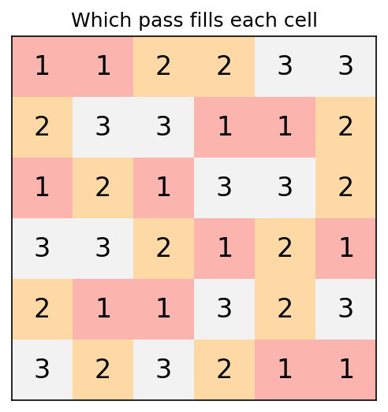
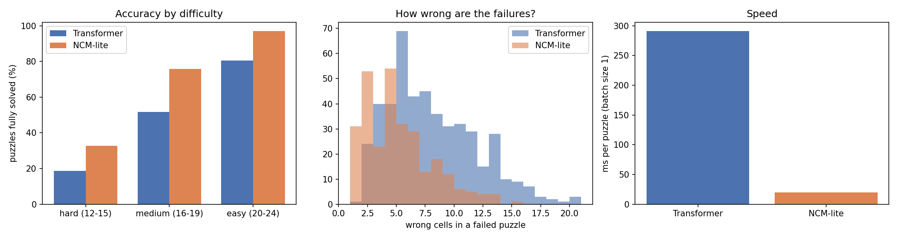

# Transformer vs NCM-lite: Solving Sudoku, Visualized

A small, hands-on project that **shows** how a transformer (word by word) and an NCM-style model (coarse to fine, many cells at once) solve the same Sudoku puzzles, and what the difference looks like in accuracy, speed and internals.

Built to learn and to explain **Next-Concept Modeling (NCM)**, a recent idea for generating text faster than normal LLMs, using a problem you can see: a 6x6 Sudoku grid.

<!-- Add your demo GIF here:  -->



---

## Contents

- [What is in this project](#what-is-in-this-project)
- [Results](#results)
- [What is NCM?](#what-is-ncm)
- [The two models](#the-two-models)
- [The Streamlit app](#the-streamlit-app)
- [Quick start](#quick-start)
- [Project structure](#project-structure)
- [Experiment setup](#experiment-setup)
- [Limitations (please read)](#limitations-please-read)
- [Future work](#future-work)
- [References](#references)

---

## What is in this project

| Part | What it does |
|---|---|
| **Sudoku engine** | Generates 6x6 puzzles with a unique solution, solves them, and checks rule violations |
| **Transformer baseline** | Decoder-only transformer. Fills the 36 cells one by one, left to right (36 forward passes) |
| **NCM-lite** | Bidirectional transformer. Fills 3 groups of 12 cells, each group in one pass (3 forward passes) |
| **Evaluation** | Same data, same size, same rules for both. Accuracy, difficulty split, speed, error size |
| **Streamlit app** | Side-by-side solving animation, a page that opens up the models (attention, probabilities), and a plain-language NCM explainer |

> **NCM-lite is a simplified teaching version, not a reproduction of the paper.** See [What is NCM?](#what-is-ncm) and [Limitations](#limitations-please-read).

---

## Results

Test set: 1,000 unseen 6x6 puzzles (12-24 clues). Both models have about 0.8M parameters, and both copy the given clues instead of predicting them.

| Metric | Transformer | NCM-lite |
|---|---|---|
| Puzzles fully solved | 53.2% (±3.1) | **71.5%** (±2.8) |
| Cell accuracy | 90.1% | **96.3%** |
| Avg. rule violations per puzzle | 2.09 | **1.14** |
| Forward passes per puzzle | 36 | **3** |
| Time per puzzle, batch size 1 | 291 ms | **19.6 ms** (about 15x faster) |
| Wrong cells in a failed puzzle (median) | 7 | **4** |

Puzzles fully solved, by difficulty (fewer clues = harder):

| Difficulty | Transformer | NCM-lite |
|---|---|---|
| Hard (12-15 clues) | 18.8% | **32.6%** |
| Medium (16-19 clues) | 51.7% | **75.8%** |
| Easy (20-24 clues) | 80.6% | **97.1%** |



**How to read these numbers**

- ± is a 95% margin of error from 1,000 test puzzles. The gap between the models is far larger than that margin.
- Timings were measured on a laptop RTX 2050. The transformer has **no KV-cache**, so its speed is pessimistic.
- This is **one training run per model** on a toy problem. See the [limitations](#limitations-please-read) before drawing big conclusions.

---

## What is NCM?

**Next-Concept Modeling (NCM)** is a text-generation method from Stanford and Together AI (arXiv 2610.14162).

### The problem with normal LLMs

- They write **one token per forward pass**. 1,000 tokens = 1,000 passes.
- A written token is never revised, so early mistakes pile up.

### The idea: sketch first, details later

NCM writes text in a few passes, from a rough sketch to fine detail, and **each pass predicts many pieces at once**.

```
Level 1   (very few codes)   -> the overall idea
Level 2   (a few more)       -> adds structure
...
Level K   (as long as text)  -> the exact words
              |
              v
   add up all levels -> decode -> final text

K is much smaller than the text length L
```

### How it works (two stages)

1. **Tokenizer (multiscale residual VQ-VAE).** Turns text into K levels of discrete codes. Each level encodes what the earlier levels still missed, and the levels get longer until the last one matches the text length.
2. **Generator (a normal transformer).** Predicts level 1, then level 2 given level 1, and so on. All codes inside one level are predicted in parallel. Then the tokenizer's decoder turns the result back into text.

### What the paper reports (its own numbers)

- Text generation: up to about 21x faster than the strongest diffusion language model on LM1B at better quality, and about 10-31x faster on other tasks (OpenWebText, XSum summarization).
- Sudoku (9x9): solves more boards than autoregressive and diffusion baselines at all difficulty levels, using 12 forward passes.
- About 4-5x fewer training tokens than strong diffusion baselines.
- Caveats: about 100M parameter models, mostly compared against diffusion language models, a preprint.

### Real NCM vs NCM-lite (this project)

| | Real NCM (paper) | NCM-lite (this project) |
|---|---|---|
| Hierarchy | **Learned** by a VQ-VAE | **Hand-made**: 3 fixed groups of cells |
| What a level holds | Codes that decode into a whole-board estimate | Actual digits for 12 cells |
| Can a later level fix an earlier mistake? | Yes, each level refines the full board | No, a written digit is final |
| Sudoku size | 9x9 | 6x6 |
| Model size | about 25M parameters | about 0.8M parameters |
| Forward passes | 12 | 3 |

NCM-lite keeps the core idea (**coarse to fine, many cells in parallel**) so you can see it work, but it does not have learned codes or self-correction.

---

## The two models

```
TRANSFORMER (causal)                         NCM-lite (bidirectional)

input: puzzle(36) + SEP + answers so far     input: 36 cells, ? = hidden
          |                                             |
 token + position embedding                   token + position + group + pass embedding
          |                                             |
 4 x [ causal self-attention                  4 x [ self-attention (NO mask)
       + feed-forward ]                             + feed-forward ]
          |                                             |
 probabilities for the NEXT cell              probabilities for ALL 36 cells
          |                                             |
 write 1 cell, repeat 36 times                keep this pass's 12 cells, repeat 3 times
```

**How the 3 groups are made.** Take a fixed valid 6x6 Sudoku and group cells by digit: digits 1-2 go to pass 1, 3-4 to pass 2, 5-6 to pass 3. Every row, column and box then has exactly 2 cells of each pass. The pattern is the same for every puzzle and does not depend on the answer.

**Why mistakes happen.** The transformer's early mistakes feed into every later step. NCM-lite's cells in the same pass cannot see each other's answers, so they can clash.

Both models use: embedding size 128, 4 layers, 4 heads, feed-forward size 512, AdamW with a one-cycle learning-rate schedule.

---

## The Streamlit app

| Page | What you get |
|---|---|
| **Main page** | Both models solve the same puzzle side by side. A slider and Play button step through forward passes. Filter puzzles, for example "Transformer fails, NCM-lite solves". Results table and charts at the bottom |
| **1 Inside the models** | Real internals of the trained models: architecture diagrams, causal vs bidirectional attention masks, attention heatmaps (pick layer and head), and probability bars for each decision |
| **2 NCM explained** | A plain-language explainer: how NCM works, applications, limitations, future scope, glossary, and the paper |

Colors on the grids: grey = given clue, green = correct, red = wrong, yellow ring = just filled, blue ring = cell being predicted or inspected.

---

## Quick start

**Requirements:** Python 3.11, an NVIDIA GPU is recommended (CPU works but is slower).

```bash
git clone https://github.com/<your-username>/<repo-name>.git
cd <repo-name>
pip install -r requirements.txt
```

For GPU training, install the CUDA build of PyTorch first (pick your command at [pytorch.org](https://pytorch.org/get-started/locally/)), for example:

```bash
pip install torch --index-url https://download.pytorch.org/whl/cu121
```

### 1. Check the Sudoku engine and groups

```bash
python -m src.sudoku      # self-test: generator, solver, checker
python -m src.groups      # builds the 3 groups and saves results/groups.png
```

### 2. Generate the dataset (about 1-5 minutes)

```bash
python -m src.dataset     # 20k train / 1k val / 1k test, saved in data/
```

### 3. Train the models (Jupyter notebooks, run cell by cell)

| Notebook | What it does |
|---|---|
| `notebooks/03_transformer_ar.ipynb` | Builds and trains the transformer, then evaluates it (including the clue-forced version used in the comparison) |
| `notebooks/04_ncm_lite.ipynb` | Builds and trains NCM-lite and prints the side-by-side table |

Training took about 15 minutes (transformer, 40 epochs) and about 10 minutes (NCM-lite, 20 epochs) on a laptop RTX 2050. The best checkpoints are saved in `checkpoints/`.

### 4. Run the full evaluation

Open `notebooks/05_evaluation.ipynb`. It produces `results/comparison.png` and `results/phase5_summary.json`.

### 5. Launch the app

```bash
python -m streamlit run app.py
```

> The checkpoints are small (about 3 MB each). If they are included in this repo, you can skip steps 2-4 for the app's solving pages, but the dataset is still needed because the app loads the test puzzles.

---

## Project structure

```
.
├── app.py                         # Streamlit main page (side-by-side solving)
├── pages/
│   ├── 1_Inside_the_models.py     # attention, probabilities, architecture
│   └── 2_NCM_explained.py         # text explainer
├── src/
│   ├── config.py                  # grid size, token ids
│   ├── sudoku.py                  # generator, solver, rule checker
│   ├── groups.py                  # the 3 cell groups for NCM-lite
│   ├── dataset.py                 # builds train/val/test files
│   ├── models.py                  # transformer and NCM-lite classes
│   ├── solvers.py                 # step-by-step solving traces for the app
│   ├── internals.py               # extracts attention and probabilities
│   └── viz.py                     # grid drawing and diagrams
├── notebooks/
│   ├── 03_transformer_ar.ipynb
│   ├── 04_ncm_lite.ipynb
│   └── 05_evaluation.ipynb
├── checkpoints/                   # ar_best.pt, ncm_best.pt
├── results/                       # metrics, charts
├── data/                          # generated (not tracked)
└── requirements.txt
```

---

## Experiment setup

- **Task:** 6x6 Sudoku with 2x3 boxes. Each puzzle has 12-24 clues and exactly one solution.
- **Data:** 19,999 train, 1,000 validation, 1,000 test puzzles. No solution appears in more than one split.
- **Fair comparison:** same data, same model size (about 0.8M parameters), and both models copy the given clues instead of predicting them.
- **Transformer:** input is `puzzle + SEP + solution`. Loss on the solution part only. At solving time it feeds its own earlier answers back in. The best checkpoint (by validation loss) is used, which came around epoch 15 of 40 (later epochs overfit).
- **NCM-lite:** all three passes are trained on every puzzle, using the true values of earlier passes. At solving time it uses its own predictions from earlier passes.
- **Metrics:** cell accuracy, fully solved puzzles (all rules satisfied and equal to the true solution), average rule violations, forward passes, time per puzzle, accuracy by difficulty, size of failures.

A note on teacher forcing: during training the transformer sees the true previous cells (98% cell accuracy), but when solving it uses its own, which is why the real result is lower. That gap is the exact weakness that parallel coarse-to-fine methods try to reduce.

---

## Limitations (please read)

This is a learning project. Please do **not** read it as "NCM beats transformers".

- **NCM-lite is not real NCM.** The hierarchy is hand-made, there are no learned codes, and it cannot fix an earlier cell.
- **Two things differ at once.** NCM-lite changes the attention type (bidirectional vs causal), the fill order (groups vs row by row) and the parallelism. Row by row is a weak order for Sudoku, so this experiment cannot say how much of the gain comes from parallel prediction itself.
- **One training run** per model, on 1,000 test puzzles.
- **Toy problem:** 6x6 Sudoku, models of about 0.8M parameters. Results do not transfer to real language models.
- **Speed numbers** come from one laptop GPU, and the transformer has no KV-cache.
- Attention heatmaps show where a model looks. They are a hint, not a full explanation of its decisions.

---

## Future work

- Separate the effects: train the transformer with the same group order as NCM-lite, and NCM-lite with causal attention.
- Let NCM-lite revise earlier cells (for example by re-predicting all cells at every pass).
- Replace the hand-made groups with learned codes (a small VQ-VAE) to get closer to the real NCM.
- Try 9x9 Sudoku and more training runs with different random seeds.
- Add KV-caching to the transformer for a fairer speed comparison.

---

## References

- **Next-Concept Modeling: Fast, Parallel Coarse-to-Fine Text Generation.** Hermann Kumbong, Ishan S. Khare, Iddah Mlauzi, Andrew Woen, Charles Ding, E. Kelly Buchanan, Simran Arora, Azalia Mirhoseini, Christopher Ré. arXiv:2610.14162 (2026). [Paper](https://arxiv.org/abs/2610.14162) · [Authors' code](https://github.com/HazyResearch/ncm)
- *Large Concept Models: Language Modeling in a Sentence Representation Space.* Meta, arXiv:2412.08821 (a different "concept" idea, based on whole sentences).
- *Visual Autoregressive Modeling: Scalable Image Generation via Next-Scale Prediction.* Tian et al., 2024 (the next-scale idea NCM extends to text).
- *Attention Is All You Need.* Vaswani et al., 2017 (the transformer).

```bibtex
@article{kumbong2026ncm,
  title   = {Next-Concept Modeling: Fast, Parallel Coarse-to-Fine Text Generation},
  author  = {Kumbong, Hermann and Khare, Ishan S. and Mlauzi, Iddah and Woen, Andrew and Ding, Charles and Buchanan, E. Kelly and Arora, Simran and Mirhoseini, Azalia and R{\'e}, Christopher},
  journal = {arXiv preprint arXiv:2610.14162},
  year    = {2026}
}
```

---

## About

Built by **<Your Name>** as a hands-on way to learn and explain transformers and NCM. Code was written with AI assistance (Claude); the experiments, results and write-up were run and checked by the author.

This project is independent and is not affiliated with the authors of the NCM paper.

## License

MIT. See `LICENSE`.